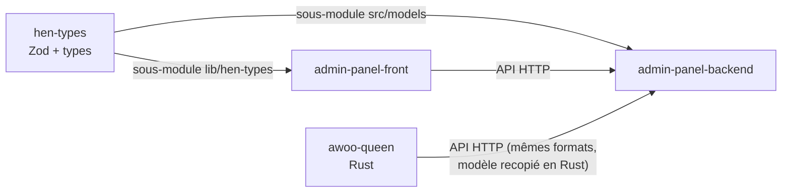

# Fluff Radio — Architecture (résumé public)

> Ce dépôt est **public** : il ne contient qu'un résumé, sans détail d'infrastructure.
> Le document complet (flux, configuration, variables d'environnement, points
> d'attention) vit dans le dépôt privé `FluffDevs/radio-config`, fichier
> `docs/ARCHITECTURE.md`, recopié dans `admin-panel-backend`, `admin-panel-front` et
> `awoo-queen`. État décrit : `main` au 2026-11-22.

## Les cinq dépôts

| Dépôt | Rôle |
|---|---|
| `admin-panel-front` | Admin en Next.js (hébergé sur Vercel) : planning, médias, playlists, animateurs |
| `admin-panel-backend` | API serverless AWS (Architect, Lambda, S3, DynamoDB, SQS), source de vérité |
| **`hen-types`** (ce dépôt) | Schémas Zod et types partagés |
| `awoo-queen` | Moteur d'antenne en Rust sur le serveur de diffusion : lit le planning, choisit les titres, pilote Liquidsoap |
| `radio-config` | Configuration du serveur de diffusion (Liquidsoap 2.4.5, Icecast, nginx, Grafana Alloy) |

Les comptes de l'équipe sont dans AWS Cognito ; la supervision passe par Grafana Cloud ;
les directs sont relayés vers Twitch.

## Place de hen-types

- `music.ts` : catalogue des médias (`MediaCategory`, `MusicMetadata`...).
- `schedule.ts` : planning (`FullSchedule`, créneaux, récurrence) et ses tests.
- `playlist.ts`, `animator.ts`, `genres.ts`, `languages.ts`.
- awoo-queen n'importe pas ce module : il réimplémente les mêmes formats en Rust. Toute
  évolution d'un schéma lu par awoo-queen doit donc être reportée à la main dans son code.

Le backend et le front pointent chacun leur sous-module sur un commit précis de
hen-types. Sur `main`, les deux pointent sur `b25270b` (le `main` actuel de ce dépôt).

## Évolutions en cours (MR ouvertes de ce dépôt)

| MR | Contenu | Utilisée par |
|---|---|---|
| [#2](https://github.com/FluffDevs/hen-types/pull/2) | `FullSchedule.timezone` (`Europe/Paris` par défaut), heures récurrentes en heure murale, `expandEventOccurrences` | backend #7, front #6 (awoo-queen #5 en Rust) |
| [#3](https://github.com/FluffDevs/hen-types/pull/3) | `explicit_restriction` (plage sans titres explicites), **empilée sur #2** | backend #9, front #9 (awoo-queen #9) |
| [#4](https://github.com/FluffDevs/hen-types/pull/4) | `lufs` et `true_peak` sur `MusicMetadata` | backend #11, front #11 (awoo-queen #11) |
| [#5](https://github.com/FluffDevs/hen-types/pull/5) | `permissions.ts` : catalogue des droits Cognito et helpers | backend #12, #13, #14 ; front #12, #13, #14, #16 |

Toutes ouvertes, aucune mergée. Ordre et procédure : [`MERGE-ORDER.md`](MERGE-ORDER.md).
