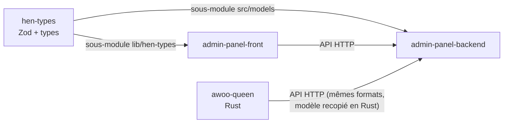

# Fluff Radio — Architecture (résumé public)

> Ce dépôt est **public** : il ne contient qu'un résumé, sans détail d'infrastructure.
> Le document complet (flux, configuration, variables d'environnement, points
> d'attention) vit dans le dépôt privé `FluffDevs/radio-config`, fichier
> `docs/ARCHITECTURE.md`, recopié dans `admin-panel-backend`, `admin-panel-front` et
> `awoo-queen`. État décrit : `main` au 2026-11-22.

## Les cinq dépôts

| Dépôt | Rôle |
|---|---|
| `admin-panel-front` | Admin en Next.js (hébergé sur Vercel) : planning, médias, playlists, animateurs |
| `admin-panel-backend` | API serverless AWS (Architect, Lambda, S3, DynamoDB, SQS), source de vérité |
| **`hen-types`** (ce dépôt) | Schémas Zod et types partagés |
| `awoo-queen` | Moteur d'antenne en Rust sur le serveur de diffusion : lit le planning, choisit les titres, pilote Liquidsoap |
| `radio-config` | Configuration du serveur de diffusion (Liquidsoap 2.4.5, Icecast, nginx, Grafana Alloy) |

Les comptes de l'équipe sont dans AWS Cognito ; la supervision passe par Grafana Cloud ;
les directs sont relayés vers Twitch.

## Place de hen-types

- `music.ts` : catalogue des médias (`MediaCategory`, `MusicMetadata`...).
- `schedule.ts` : planning (`FullSchedule`, créneaux, récurrence) et ses tests.
- `playlist.ts`, `animator.ts`, `genres.ts`, `languages.ts`.
- awoo-queen n'importe pas ce module : il réimplémente les mêmes formats en Rust. Toute
  évolution d'un schéma lu par awoo-queen doit donc être reportée à la main dans son code.

Le backend et le front pointent chacun leur sous-module sur un commit précis de
hen-types. Sur `main`, les deux pointent sur `b25270b` (le `main` actuel de ce dépôt).

## Contenu de l'intégration de novembre 2026

Les MR ouvertes des cinq dépôts sont regroupées en **une MR d'intégration par dépôt**
(branche `integration/novembre-2026`) ; les MR d'origine sont fermées, non supprimées.
Pour ce dépôt : [hen-types #7](https://github.com/FluffDevs/hen-types/pull/7). Les MR
d'intégration du backend et du front pointent leur sous-module sur `ed2a13d` (branche
d'intégration de hen-types).

| Fonctionnalité | Ajout dans hen-types | Utilisée par (MR d'intégration) |
|---|---|---|
| Fuseau horaire du planning | `FullSchedule.timezone` (`Europe/Paris` par défaut), heures récurrentes en heure murale, `expandEventOccurrences` | [backend #17](https://github.com/FluffDevs/admin-panel-backend/pull/17), [front #19](https://github.com/MatheoCASSY/admin-panel-front/pull/19), [awoo-queen #14](https://github.com/FluffDevs/awoo-queen/pull/14) (en Rust) |
| Pas d'explicite sur une plage horaire | `explicit_restriction` et helpers | backend #17, front #19, awoo-queen #14 |
| Volume mesuré à l'upload | `lufs` et `true_peak` sur `MusicMetadata` | backend #17, front #19, awoo-queen #14 |
| Refonte des droits | `permissions.ts` : catalogue des droits et helpers | backend #17, front #19 |
| CI du front | directive eslint sur la ligne du `type Json` de `schedule.ts` | front #19 |

Ordre de merge : **hen-types #7 en premier** (puis re-pointer les sous-modules du backend
et du front sur `main` de hen-types), puis la configuration du serveur de diffusion
([radio-config #8](https://github.com/FluffDevs/radio-config/pull/8)), puis backend #17
et awoo-queen #14 ensemble, puis front #19. Détail : [`MERGE-ORDER.md`](MERGE-ORDER.md).
